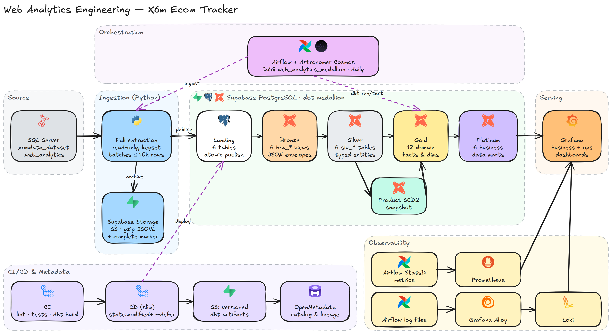
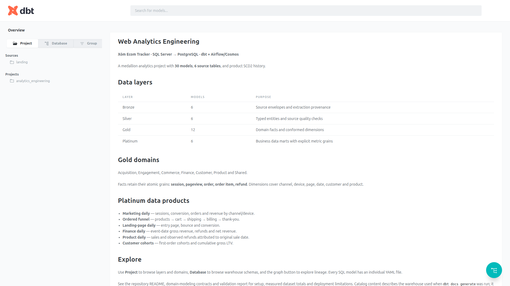
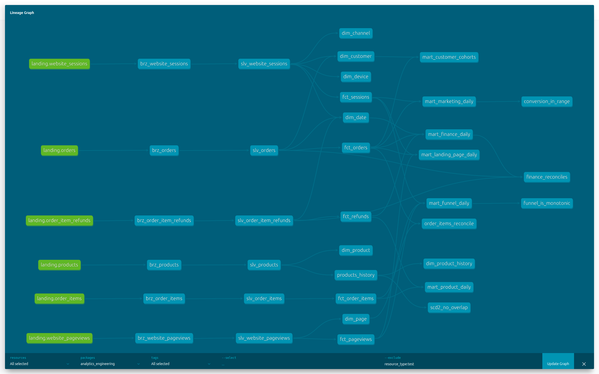
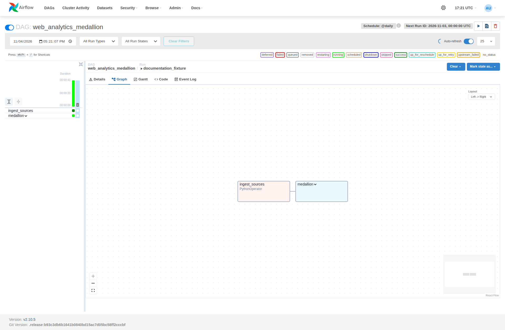
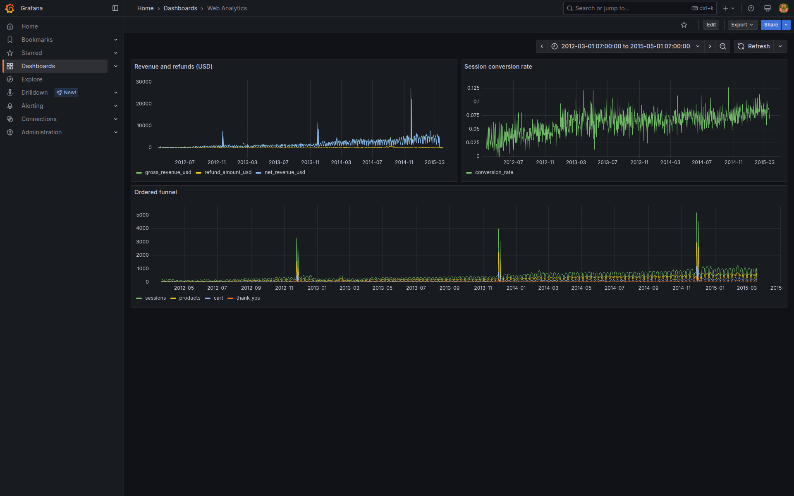
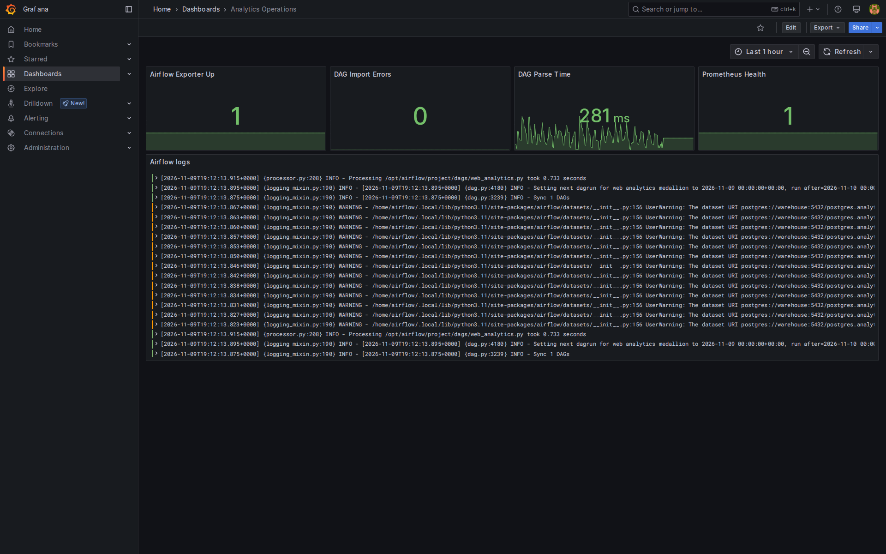
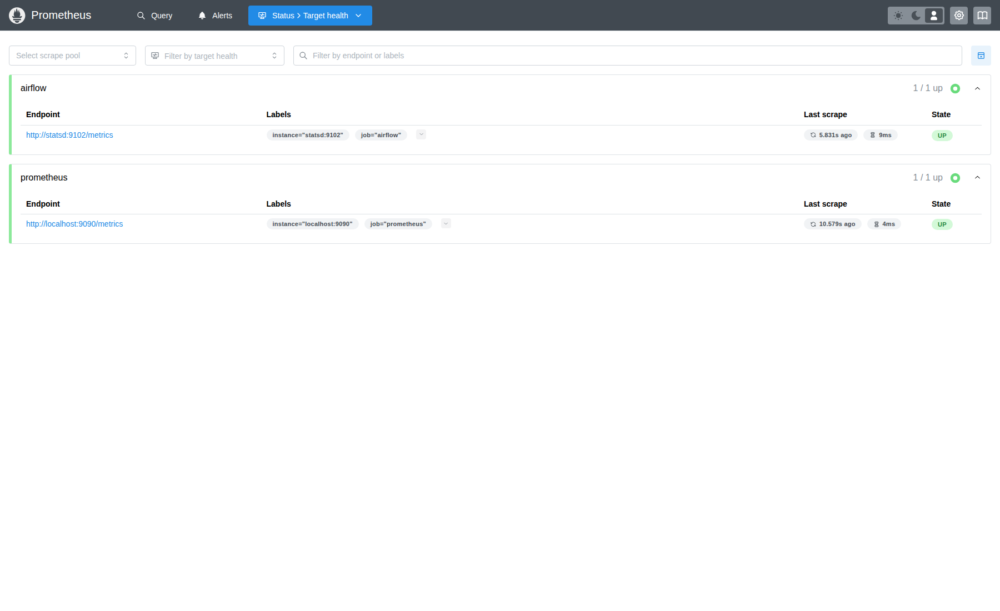
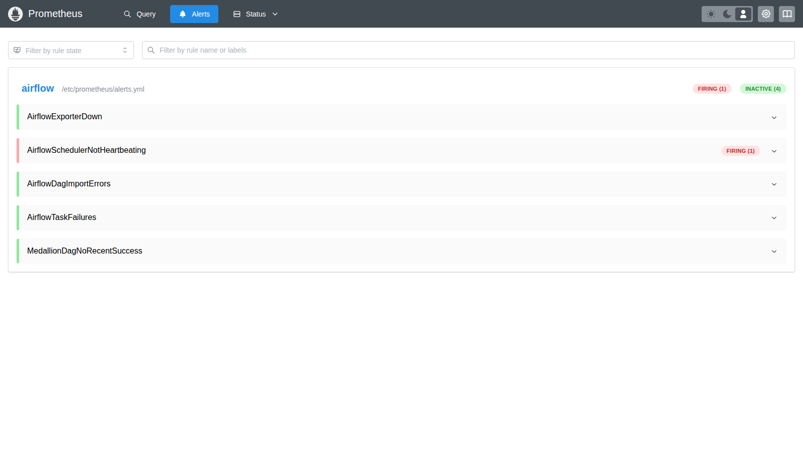
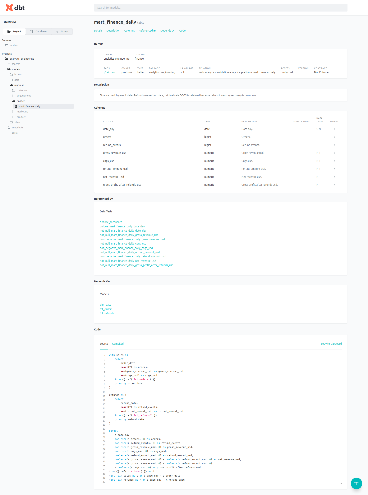
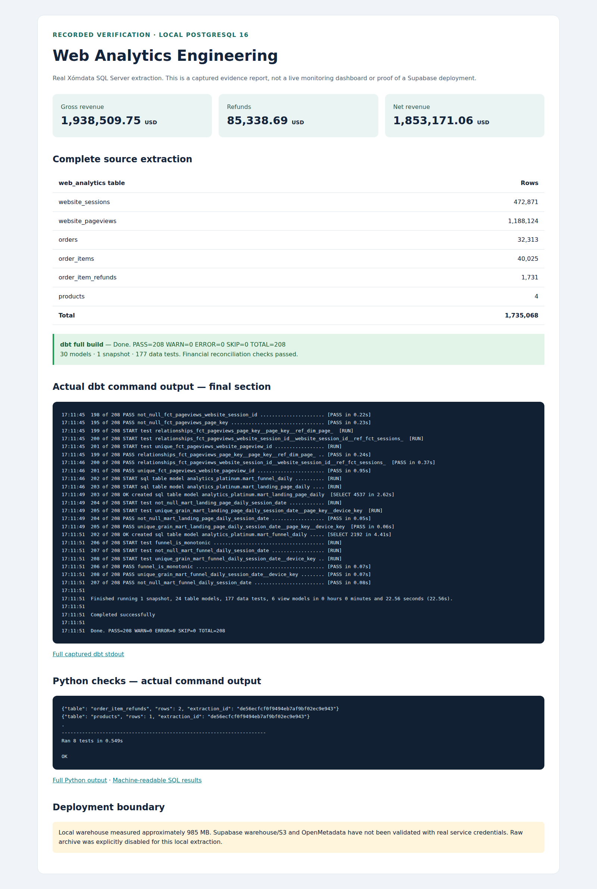

# Web Analytics Engineering — Xóm Ecom Tracker

[Tiếng Việt](README.md) | **English**

Pipeline: SQL Server → Supabase PostgreSQL/Storage → dbt medallion → domain models → data marts. The real source is the [Xóm Dataset web_analytics](https://dataset.xomdata.com/datasets/schema/web_analytics) schema: sessions, pageviews, orders, order items, refunds and products. Source credentials live only in a local, git-ignored `.env`.


*Overall architecture. Editable Excalidraw source: [architecture.excalidraw](docs/images/architecture.excalidraw) (open it at [excalidraw.com](https://excalidraw.com)); regenerate with `python scripts/build_architecture_diagram.py`.*

## Layers and modeling

| Layer | Contents | Grain / role |
|---|---|---|
| Landing | `landing_web_analytics`, 6 tables + ingestion_runs | Current full extraction; all 6 tables are published in a single PostgreSQL transaction |
| Bronze | 6 `brz_*` views | Source ID + JSON payload + hash + extraction metadata |
| Silver | 6 `slv_*` tables | Typed source records, PK/FK tests, empty strings normalized; source datetimes kept as-is because the timezone is not documented |
| Gold | 12 domain models | Conformed dimensions and atomic facts; no dashboard KPIs inside facts |
| Platinum | 6 data marts | Grain and metrics tailored to each analytical need |

Every SQL model has a YAML file with the same name: description, columns, tests and domain metadata. See [domain design and metric contracts](docs/domain-modeling.md).


*Figure 1: Overview of the medallion structure and domain facts/marts in dbt docs.*


*Figure 2: Full lineage graph from Landing through Bronze, Silver and Gold to the Platinum marts and custom data tests.*

**Gold domains:**

- Acquisition: `dim_channel`, `fct_sessions`.
- Engagement: `dim_page`, `fct_pageviews`.
- Commerce: `fct_orders`, `fct_order_items`.
- Finance: `fct_refunds`.
- Customer: `dim_customer`.
- Product: `dim_product`, `dim_product_history`.
- Shared: `dim_date`, `dim_device`.

**Platinum marts:** `mart_marketing_daily`, `mart_funnel_daily`, `mart_landing_page_daily`, `mart_finance_daily`, `mart_product_daily`, `mart_customer_cohorts`.

## Offline demo

Requires Docker Compose, Python 3.11 and uv. The synthetic fixture contains multiple orders per session, multiple refunds per item and out-of-order funnels to catch fanout and metric bugs.

```bash
make install
make demo
make validate
```

The demo uses a local PostgreSQL (`localhost:5432`, postgres/local-only) and skips S3 via an explicit CLI flag. No SQL Server/Supabase credentials are needed. Do not source the Supabase `.env` when running the demo. Bootstrap `.env` from `.env.example` if it does not exist yet; an existing local `.env` with filled-in credentials must be left untouched.

## Loading real data

`.env` holds two separate groups of variables:

- `MSSQL_*`: the Xómdata source, database `xomdata_dataset`, schema `web_analytics`; the account is used for SELECT only.
- `PG*`: the Supabase warehouse, project `hdbmxpzqzpagrbfqrcdn`; `S3_*` and `AWS_*`: Supabase Storage S3 access credentials, the actual region and the private bucket `analytics`.

Do not source `.env` from the shell if passwords contain special characters; use the dotenv loader below to pass values verbatim:

```bash
.venv/bin/python -m scripts.with_env .venv/bin/python -m ingestion.web_analytics
.venv/bin/python -m scripts.with_env .venv/bin/dbt build --project-dir dbt --profiles-dir dbt --target prod
```

`with_env` reads each `KEY=value` line, never invokes a shell and never prints secrets. The sample file [.env.supabase.example](.env.supabase.example) leaves credentials blank. Fill in the target database password and S3 keys before a real load.

The tested Supabase direct endpoint only resolves to IPv6 in this environment and reports network unreachable. Take the exact host/user/port from **Supabase → Connect → Session pooler** and update `PGHOST`, `PGUSER`, `PGPORT` and `AIRFLOW_PGHOST`. Do not guess the pooler hostname. [Supabase connection guide](https://supabase.com/docs/guides/database/connecting-to-postgres)

The source has no updated_at/CDC, so the pipeline does a full extract with keyset pagination, at most 10,000 rows per batch; `Decimal` values are serialized as strings to preserve precision. Once all 6 tables are extracted, a transaction publishes landing and writes ingestion_runs; any failure rolls back the whole landing. An advisory lock prevents two concurrent ingestion writers. S3 stores gzip JSONL per extraction ID, with a complete marker written after the DB commit. There is no distributed transaction between S3 and Postgres: a marker failure after commit needs a retry, and raw batches without a complete marker are not a published snapshot. The source is currently read with READ COMMITTED per query; the row-count guard catches some changes but does not guarantee point-in-time consistency if the source is being updated.

To validate the real source against a local PostgreSQL, point `PG*` at local and run the same CLI with `--no-archive`. This is an explicit verification mode that does not store raw data in S3.

## Airflow and observability

```bash
make platform
```

DAG `web_analytics_medallion`: full ingestion → Cosmos dbt graph (models, snapshot, tests), daily, no catchup. dbt lives in its own venv; both render time and execution use the same executable. Docker reads `.env`; `AIRFLOW_PGHOST` defaults to `warehouse` for the local demo and must be changed when using Supabase. Grafana's local `PGHOST` must be `warehouse` inside the container, while the CLI host uses `localhost`.

Airflow http://localhost:8080 (standalone generates credentials in the logs), Grafana http://localhost:3000, Prometheus http://localhost:9090. The Web Analytics dashboard covers finance, conversion, funnel, exporter health and logs; the default date range 2012–2015 matches the historical dataset. Dashboard SQL uses the `analytics_platinum` schema; adjust it if you change DBT_SCHEMA. In real operation, the Grafana business datasource should use a read-only DB user.

Prometheus collects metrics via StatsD; Alloy ships Airflow log files to Loki. dbt docs/lineage: run `dbt docs generate` and `dbt docs serve` with `.venv/bin/dbt`, plus `--project-dir dbt --profiles-dir dbt`. Airflow standalone and Docker Compose are development environments; the OpenMetadata server is deployed separately.

**Alerting.** Every failed task calls `on_failure_callback` ([dags/callbacks.py](dags/callbacks.py)): it always logs, and when `ALERT_WEBHOOK_URL` is set it posts a Slack/Mattermost/Google Chat-compatible `{"text": ...}` JSON. The DAG has a 3-hour `dagrun_timeout`. Prometheus loads [observability/alerts.yml](observability/alerts.yml): exporter down, scheduler not heartbeating, DAG import errors, task failures, and `web_analytics_medallion` not succeeding for 26 hours. Alerts show in Prometheus `/alerts` and in Grafana Alerting; add Alertmanager to route them to chat or e-mail.

### Platform & observability evidence


*Figure 3: The `web_analytics_medallion` pipeline in the Airflow UI (full ingestion + Cosmos dbt task groups).*


*Figure 4: Grafana business analytics dashboard (net/gross revenue, session conversion rate and ordered funnel 2012–2015).*


*Figure 5: Operations dashboard for the Airflow exporter and the live log stream from Loki via Alloy.*


*Figure 6: Prometheus target health, collecting real-time metrics from the StatsD exporter and Airflow.*


*Figure 7: Airflow alert rules; `AirflowSchedulerNotHeartbeating` is firing because Airflow was stopped on purpose during testing.*

Re-capture these screenshots from the local platform with `cd tools/docs && npm install && npm run screenshots` (environment variables are listed at the top of [capture.cjs](tools/docs/capture.cjs)).

## CI/CD and metadata

CI: Black, SQLFluff, Python tests, dbt parse/compile/build on a clean PostgreSQL with the synthetic fixture. dbt Core has no general `dbt validate` command; these steps perform the validation.

Auto CD runs after a successful CI push to main and checks out the exact SHA: download the production manifest into a dedicated state directory → `compile/build/test --select state:modified+ --state ... --defer` → generate the full manifest/catalog → upload immutable artifacts → slim dbt metadata ingestion → promote `production/latest.json` on success. `build` already includes tests; the separate `test` phase satisfies the required pipeline. `docs generate` reads the full catalog and may compile the full graph.

Manual CD via Actions → CD → Run workflow: full build/test/docs and full dbt ingestion; run it first to bootstrap the baseline. A missing baseline makes slim CD fail. A full build does not reset SCD2 history and does not drop stale relations from earlier demos; handle cleanup with a reviewed migration.

The GitHub `production` environment uses the secrets `PGHOST`, `PGPORT`, `PGDATABASE`, `PGUSER`, `PGPASSWORD`, `S3_ENDPOINT_URL`, `S3_BUCKET`, `AWS_ACCESS_KEY_ID`, `AWS_SECRET_ACCESS_KEY`, `OPENMETADATA_HOST`, `OPENMETADATA_JWT`. The variable `OPENMETADATA_VERSION` must match the server exactly, `OPENMETADATA_SERVICE` defaults to supabase, and `AWS_DEFAULT_REGION` must match the Storage settings. MSSQL credentials belong to the Airflow runtime and are not needed for dbt deployment. CI never touches the real source.

The scheduled DAG does a full build to pick up data changes; slim CD detects code changes and does not replace the scheduled refresh. dbt state lives outside target; defer uses upstream production for sandboxes. CD concurrency only locks CD; avoid CD and the DAG writing to the same warehouse at the same time. A PostgreSQL transaction does not span the whole dbt graph, so a failed CD may already have changed some relations even though the manifest was not promoted.

CD ingests into OpenMetadata in three steps ([scripts/metadata_ingest.py](scripts/metadata_ingest.py)), after uploading artifacts and before promoting the manifest:

1. **Governance bootstrap** ([scripts/openmetadata_bootstrap.py](scripts/openmetadata_bootstrap.py)): idempotently creates or updates the `analytics-engineering` team, 9 domains, the `WebAnalytics` glossary, the `Sensitivity` classification and the Grafana dashboard `grafana.web-analytics`. dbt ingestion only *links* to these entities; it never creates them.
2. **PostgreSQL metadata**: the `landing_web_analytics` and `<DBT_SCHEMA>_(bronze|silver|gold|platinum|history)` schemas, with tables, views, DDL and comments; tables that no longer exist are marked deleted. Always runs in full so new tables exist in the catalog before dbt.
3. **dbt**: table and column descriptions, owners, domains, tiers, glossary terms, `Sensitivity.Confidential` tags on `user_id`, lineage landing → bronze → silver → gold → platinum → dashboard (via the exposure), raw and compiled SQL, and dbt test results. Slim mode ingests only the models in `state:modified+`.

The declarations live in dbt: `meta.owner` and `meta.openmetadata.{domain, tier}` on models and sources, `meta.openmetadata.{glossary, tags}` on columns. [test_metadata_ingest.py](tests/test_metadata_ingest.py) checks that every referenced name is created by the bootstrap, and the `openmetadata-config` CI job validates the workflows with the pinned SDK. Verified end-to-end against a local OpenMetadata 2.0.7: 38/38 tables have an owner, domain, tier and description, with 0 warnings ([details](docs/validation.md#openmetadata-ingestion)). Optional secrets `OPENMETADATA_PGUSER`/`OPENMETADATA_PGPASSWORD` set a read-only catalog user (defaults to `PG*`); the `GRAFANA_URL` variable sets the dashboard link. [DAMA governance and setup](docs/governance.md).

## Tests and SCD2

Custom tests: unique mart grain, ordered funnel monotonicity, session conversion within [0,1], header/items reconciliation, finance reconciliation and non-overlapping SCD2. Net revenue and gross profit can be negative on refund-only days, so no non-negative test is applied to signed metrics.

The 6 Platinum marts have model contracts (`contract.enforced` plus a `data_type` per column) because Grafana reads these tables directly. dbt unit tests check metric logic on fixed inputs: the funnel only counts steps taken in order, a refund-only day yields negative net revenue, and a session with two orders counts as one converted session. Source freshness uses `ingested_at` (and `published_at` for `ingestion_runs`): warn after 36 hours, error after 72 hours; CI runs `dbt source freshness`. The `grafana_web_analytics` exposure declares which marts the dashboard depends on.


*Figure 8: The `mart_finance_daily` model, its reconciliation test and SQL contract.*

`products_history` uses a dbt check snapshot on product_name because the source has no updated_at. `dim_product` holds the current product; `dim_product_history` holds the observed SCD2 versions. Facts join on the stable product_id; history observed today is not attributed to sales from 2012. The `scd2_key`/`scd2_current` macros support key generation and current-snapshot selection.

Dependencies are pinned as a reproducible baseline; review security updates before production. The real Supabase warehouse/Storage and OpenMetadata deployments count as done only after credentials are in place and end-to-end verification has passed.

## Validation results and capacity

A full extract of 1,735,068 real source rows was completed, and 30 models, 1 snapshot and 177 dbt tests built successfully on a local PostgreSQL. [Details of results and limitations](docs/validation.md). The database measured about 985 MB, exceeding the [500 MB quota of Supabase Free](https://supabase.com/docs/guides/platform/billing-on-supabase); do not load the full dataset with the current materializations into the Free tier until storage is addressed.


*Figure 9: Comprehensive validation evidence report — full extraction of 1,735,068 rows, 208/208 nodes PASS (30 models, 1 snapshot, 177 data tests), finance reconciled 100%.*
