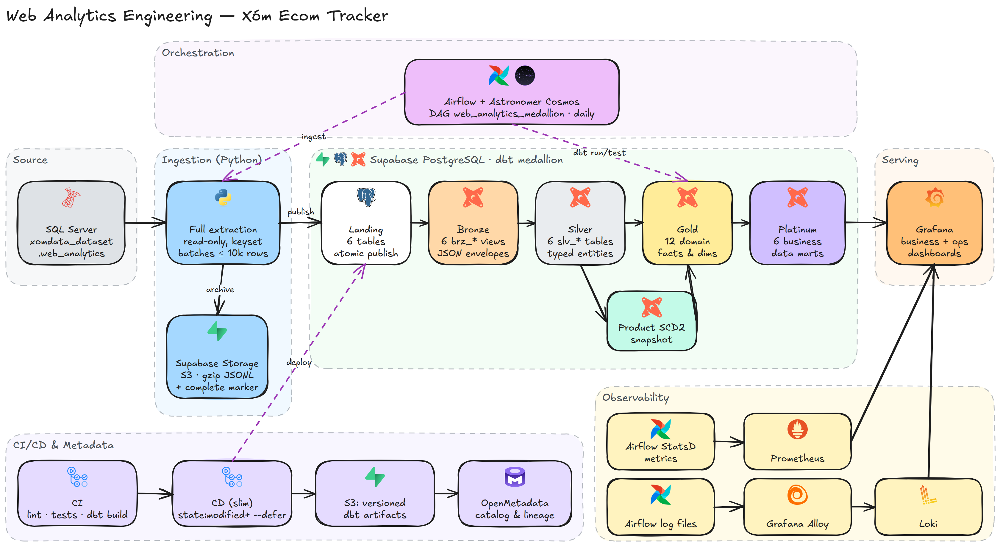
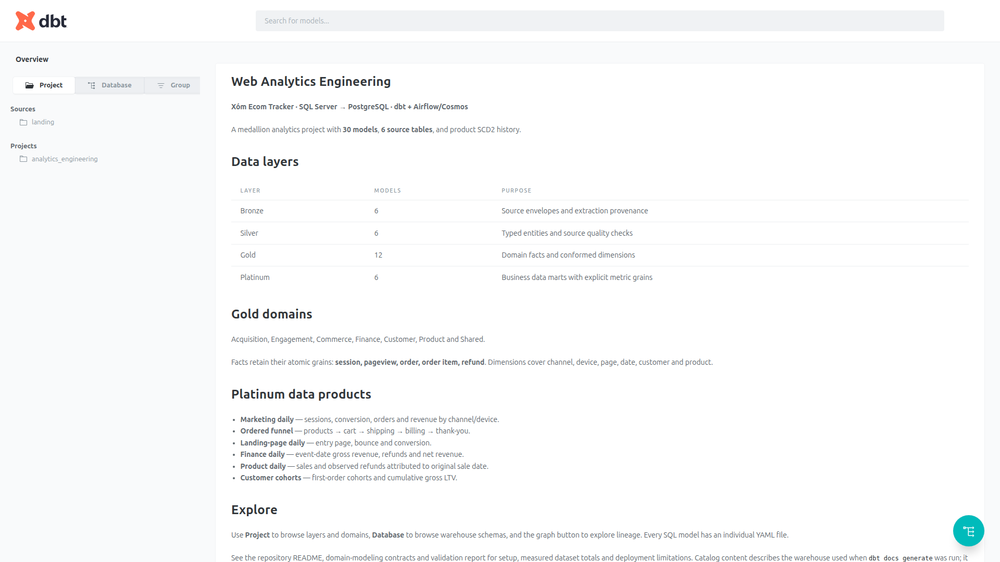
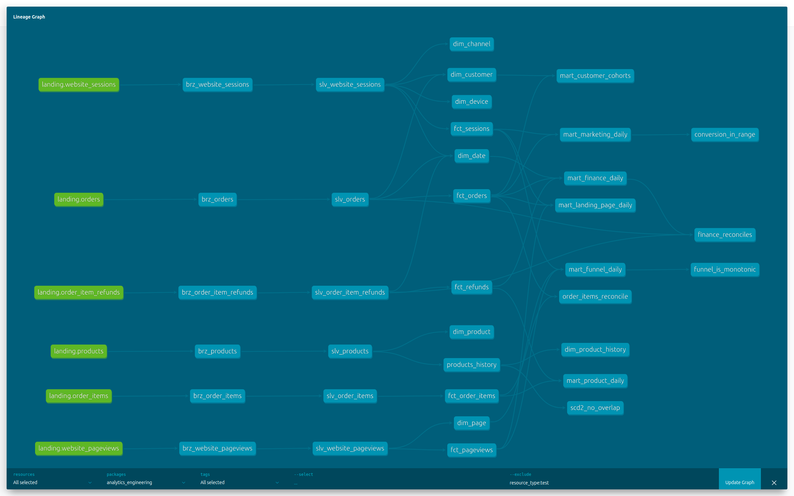
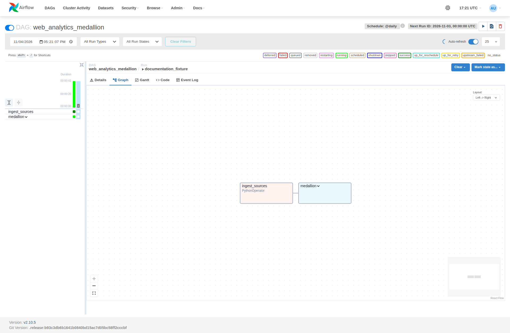
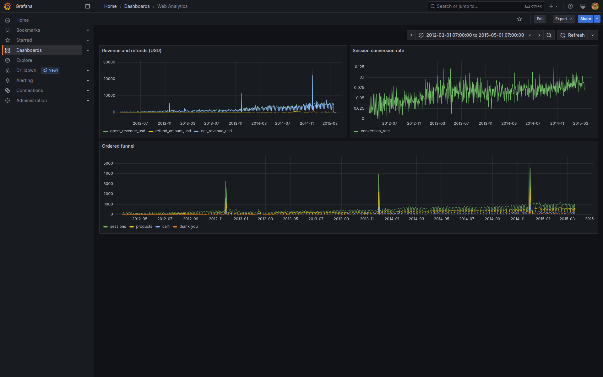
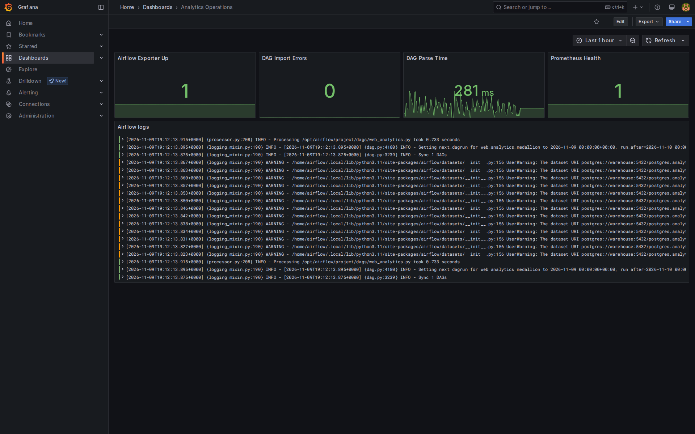
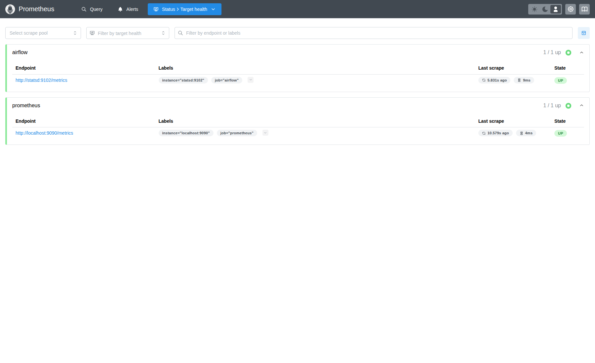
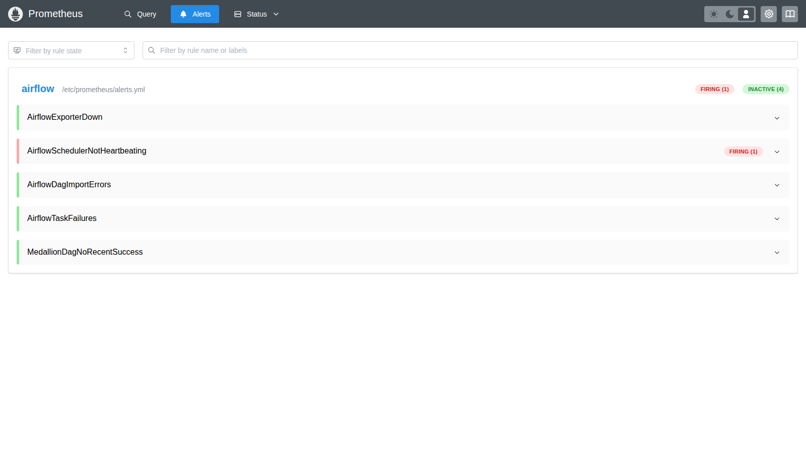
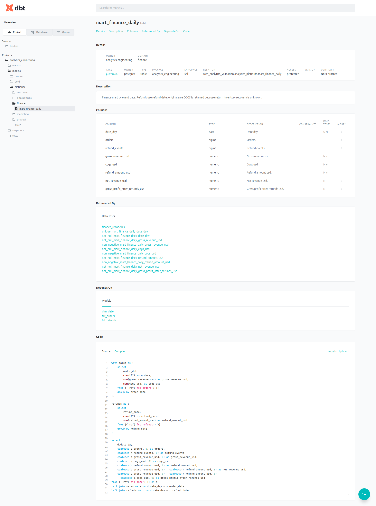
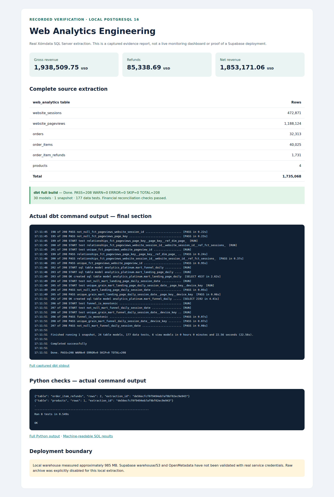

# Web Analytics Engineering — Xóm Ecom Tracker

**Tiếng Việt** | [English](README.en.md)

Pipeline SQL Server → Supabase PostgreSQL/Storage → dbt medallion → domain models → data marts. Nguồn thực tế là [Xóm Dataset web_analytics](https://dataset.xomdata.com/datasets/schema/web_analytics): sessions, pageviews, orders, order items, refunds và products. Credentials nguồn chỉ nằm trong `.env` local được git-ignore.


*Kiến trúc tổng thể. Nguồn Excalidraw có thể chỉnh sửa: [architecture.excalidraw](docs/images/architecture.excalidraw) (mở bằng [excalidraw.com](https://excalidraw.com)); sinh lại bằng `python scripts/build_architecture_diagram.py`.*

## Layers và modeling

| Layer | Nội dung | Grain / vai trò |
|---|---|---|
| Landing | `landing_web_analytics`, 6 tables + ingestion_runs | Full extraction hiện tại; publish cả 6 tables trong một PostgreSQL transaction |
| Bronze | 6 `brz_*` views | Source ID + JSON payload + hash + extraction metadata |
| Silver | 6 `slv_*` tables | Typed source records, PK/FK tests, chuẩn hóa chuỗi rỗng; datetime nguồn giữ nguyên vì timezone chưa được công bố |
| Gold | 12 models theo domain | Conformed dimensions và atomic facts; không đặt KPI dashboard vào fact |
| Platinum | 6 data marts | Grain và metric dành cho từng nhu cầu phân tích |

Mỗi SQL model có YAML cùng tên: description, columns, tests và domain metadata. Xem [thiết kế domain và metric contracts](docs/domain-modeling.md).


*Hình 1: Tổng quan cấu trúc Medallion và Domain facts/marts trong dbt docs.*


*Hình 2: Lineage graph hoàn chỉnh từ Landing qua Bronze, Silver, Gold đến Platinum marts và các custom data tests.*

**Gold domains:**

- Acquisition: `dim_channel`, `fct_sessions`.
- Engagement: `dim_page`, `fct_pageviews`.
- Commerce: `fct_orders`, `fct_order_items`.
- Finance: `fct_refunds`.
- Customer: `dim_customer`.
- Product: `dim_product`, `dim_product_history`.
- Shared: `dim_date`, `dim_device`.

**Platinum marts:** `mart_marketing_daily`, `mart_funnel_daily`, `mart_landing_page_daily`, `mart_finance_daily`, `mart_product_daily`, `mart_customer_cohorts`.

## Demo offline

Yêu cầu Docker Compose, Python 3.11 và uv. Fixture tổng hợp có nhiều orders trong một session, nhiều refunds cho một item và funnel đi sai thứ tự để kiểm tra lỗi fanout/metric.

```bash
make install
make demo
make validate
```

Demo dùng PostgreSQL local (`localhost:5432`, postgres/local-only), bỏ qua S3 bằng flag CLI rõ ràng. Không cần credentials SQL Server/Supabase. Không source `.env` Supabase khi chạy demo. Cài đặt ban đầu `.env` bằng `.env.example` nếu chưa có; `.env` local hiện có phải được giữ nguyên khi đã điền credentials.

## Nạp dữ liệu thật

`.env` chứa hai nhóm biến riêng:

- `MSSQL_*`: nguồn Xómdata, database `xomdata_dataset`, schema `web_analytics`; tài khoản chỉ được dùng để SELECT.
- `PG*`: warehouse Supabase project `hdbmxpzqzpagrbfqrcdn`; `S3_*` và `AWS_*`: Supabase Storage S3 access credentials, region thực tế và private bucket `analytics`.

Không source `.env` bằng shell nếu password có ký tự đặc biệt; dùng dotenv loader dưới đây để truyền nguyên giá trị:

```bash
.venv/bin/python -m scripts.with_env .venv/bin/python -m ingestion.web_analytics
.venv/bin/python -m scripts.with_env .venv/bin/dbt build --project-dir dbt --profiles-dir dbt --target prod
```

`with_env` đọc từng dòng `KEY=value`, không chạy shell và không in secrets. File mẫu [.env.supabase.example](.env.supabase.example) để trống credentials. Điền password database đích và S3 keys trước khi nạp thật.

Direct endpoint Supabase đã kiểm tra chỉ trả IPv6 trong môi trường này và báo network unreachable. Lấy host/user/port chính xác từ **Supabase → Connect → Session pooler**, cập nhật `PGHOST`, `PGUSER`, `PGPORT` và `AIRFLOW_PGHOST`. Không suy đoán pooler hostname. [Supabase connection guide](https://supabase.com/docs/guides/database/connecting-to-postgres)

Nguồn không có updated_at/CDC nên pipeline full-extract bằng keyset pagination, mỗi batch tối đa 10.000 dòng; `Decimal` được serialize thành chuỗi để giữ precision. Sau khi đủ 6 bảng, transaction publish landing và ghi ingestion_runs; failure rollback toàn bộ landing. Advisory lock chặn hai ingestion writer đồng thời. S3 giữ gzip JSONL theo extraction ID, có complete marker sau DB commit. Không có distributed transaction giữa S3/Postgres: marker lỗi sau commit cần retry; raw batches chưa complete không phải snapshot đã publish. Hiện nguồn đọc theo READ COMMITTED từng query; row-count guard phát hiện một số thay đổi nhưng không đảm bảo point-in-time consistency nếu nguồn đang cập nhật.

Để xác thực nguồn thật vào PostgreSQL local, đặt `PG*` về local và chạy cùng CLI với `--no-archive`. Đây là chế độ verification tường minh, không lưu raw lên S3.

## Airflow và observability

```bash
make platform
```

DAG `web_analytics_medallion`: full ingestion → Cosmos dbt graph (models, snapshot, tests), daily, không catchup. dbt đặt trong venv riêng; cả render-time và execution dùng đúng executable. Docker đọc `.env`; `AIRFLOW_PGHOST` mặc định `warehouse` cho demo local và phải đổi khi dùng Supabase. `PGHOST` của Grafana local phải là `warehouse` trong container, còn CLI host dùng `localhost`.

Airflow http://localhost:8080 (standalone sinh credentials trong logs), Grafana http://localhost:3000, Prometheus http://localhost:9090. Dashboard Web Analytics có finance, conversion, funnel, exporter health và logs; khoảng ngày mặc định 2012–2015 khớp dataset lịch sử. SQL dashboard dùng schema `analytics_platinum`; sửa nếu đổi DBT_SCHEMA. Grafana business datasource nên dùng DB user chỉ đọc khi vận hành thật.

Prometheus thu metrics qua StatsD; Alloy chuyển Airflow log files sang Loki. dbt docs/lineage: chạy `dbt docs generate` và `dbt docs serve` bằng `.venv/bin/dbt`, kèm `--project-dir dbt --profiles-dir dbt`. Airflow standalone và Docker Compose là môi trường phát triển; server OpenMetadata triển khai riêng.

**Alerting.** Mọi task lỗi gọi `on_failure_callback` ([dags/callbacks.py](dags/callbacks.py)): luôn ghi log, và nếu đặt `ALERT_WEBHOOK_URL` thì gửi JSON `{"text": ...}` tương thích Slack/Mattermost/Google Chat. DAG có `dagrun_timeout` 3 giờ. Prometheus nạp [observability/alerts.yml](observability/alerts.yml): exporter down, scheduler ngừng heartbeat, DAG import errors, task failures và `web_analytics_medallion` không thành công trong 26 giờ. Alert hiện ở Prometheus `/alerts` và Grafana Alerting; muốn gửi ra chat/e-mail thì thêm Alertmanager.

### Minh chứng vận hành Platform & Observability


*Hình 3: Pipeline orchestration `web_analytics_medallion` trong Airflow UI (Full Ingestion + Cosmos dbt Task Groups).*


*Hình 4: Grafana Business Analytics Dashboard (Doanh thu net/gross, Session Conversion Rate và Ordered Funnel 2012–2015).*


*Hình 5: Dashboard giám sát vận hành Airflow exporter và live log stream từ Loki qua Alloy.*


*Hình 6: Prometheus Target Health thu thập metrics thời gian thực từ StatsD exporter và Airflow.*


*Hình 7: Alert rules của Airflow; `AirflowSchedulerNotHeartbeating` đang firing vì Airflow được dừng có chủ đích khi kiểm thử.*

Chụp lại các hình trên từ platform local: `cd tools/docs && npm install && npm run screenshots` (xem biến môi trường ở đầu [capture.cjs](tools/docs/capture.cjs)).

## CI/CD và metadata

CI: Black, SQLFluff, Python tests, dbt parse/compile/build trên PostgreSQL sạch với fixture tổng hợp. dbt Core không có command tổng quát `dbt validate`; các bước này thực hiện validation.

Auto CD chạy sau CI push main thành công, checkout đúng SHA: tải manifest production vào state directory riêng → `compile/build/test --select state:modified+ --state ... --defer` → generate full manifest/catalog → upload immutable artifacts → slim dbt metadata ingestion → promote `production/latest.json` sau thành công. `build` đã bao gồm tests; phase `test` riêng đáp ứng pipeline yêu cầu. `docs generate` đọc full catalog và có thể compile full graph.

Manual CD bằng Actions → CD → Run workflow: full build/test/docs và full dbt ingestion; chạy đầu tiên để bootstrap baseline. Missing baseline khiến slim fail. Full build không reset lịch sử SCD2 và không tự drop relations cũ từ demo trước; xử lý cleanup bằng migration sau review.

GitHub environment `production` dùng secrets `PGHOST`, `PGPORT`, `PGDATABASE`, `PGUSER`, `PGPASSWORD`, `S3_ENDPOINT_URL`, `S3_BUCKET`, `AWS_ACCESS_KEY_ID`, `AWS_SECRET_ACCESS_KEY`, `OPENMETADATA_HOST`, `OPENMETADATA_JWT`. Variables `OPENMETADATA_VERSION` bắt buộc đúng bằng server, `OPENMETADATA_SERVICE` mặc định supabase, `AWS_DEFAULT_REGION` phải khớp Storage settings. Credentials MSSQL thuộc runtime Airflow, không cần cho deployment dbt. CI không truy cập nguồn thật.

Scheduled DAG full-build để nhận thay đổi dữ liệu; slim CD phát hiện thay đổi code, không thay thế scheduled refresh. dbt state nằm ngoài target; defer dùng upstream production cho sandbox. CD concurrency chỉ khóa CD; tránh CD và DAG ghi cùng warehouse đồng thời. PostgreSQL transaction không bao phủ toàn dbt graph, nên CD fail có thể đã thay đổi một số relations dù chưa promote manifest.

CD ingest OpenMetadata theo ba bước ([scripts/metadata_ingest.py](scripts/metadata_ingest.py)), chạy sau khi upload artifacts và trước khi promote manifest:

1. **Bootstrap governance** ([scripts/openmetadata_bootstrap.py](scripts/openmetadata_bootstrap.py)): tạo/cập nhật idempotent team `analytics-engineering`, 9 domains, glossary `WebAnalytics`, classification `Sensitivity` và dashboard Grafana `grafana.web-analytics`. dbt ingestion chỉ *liên kết* các entity này, không tự tạo.
2. **PostgreSQL metadata**: schemas `landing_web_analytics` và `<DBT_SCHEMA>_(bronze|silver|gold|platinum|history)`, gồm tables, views, DDL và comments; đánh dấu xóa tables không còn tồn tại. Luôn chạy full để table mới có trong catalog trước dbt.
3. **dbt**: descriptions (bảng + cột), owners, domains, tiers, glossary terms, tags `Sensitivity.Confidential` cho `user_id`, lineage landing → bronze → silver → gold → platinum → dashboard (qua exposure), raw + compiled SQL, và kết quả dbt tests. Slim chỉ ingest các models trong `state:modified+`.

Khai báo nằm trong dbt: `meta.owner`, `meta.openmetadata.{domain, tier}` ở model/source, `meta.openmetadata.{glossary, tags}` ở cột. Test [test_metadata_ingest.py](tests/test_metadata_ingest.py) đảm bảo mọi tên được tham chiếu đều được bootstrap tạo; job CI `openmetadata-config` kiểm tra workflow bằng SDK đã pin. Đã chạy end-to-end với OpenMetadata 2.0.7 local: 38/38 tables có owner, domain, tier và mô tả; 0 warning ([chi tiết](docs/validation.md#openmetadata-ingestion)). Secrets tùy chọn `OPENMETADATA_PGUSER`/`OPENMETADATA_PGPASSWORD` cho catalog user chỉ đọc (mặc định dùng `PG*`); variable `GRAFANA_URL` cho link dashboard. [DAMA governance và setup](docs/governance.md).

## Tests và SCD2

Custom tests: unique mart grain, ordered funnel monotonicity, session conversion trong [0,1], header/items reconciliation, finance reconciliation và SCD2 không overlap. Net revenue và gross profit có thể âm trên ngày chỉ có refunds, nên không áp non-negative cho signed metrics.

6 Platinum marts có model contract (`contract.enforced` + `data_type` từng cột) vì Grafana đọc trực tiếp các bảng này. dbt unit tests kiểm tra logic metric bằng dữ liệu cố định: funnel chỉ tính bước đúng thứ tự, ngày chỉ có refund ra net âm, và một session hai orders được tính một converted session. Source freshness dùng `ingested_at` (và `published_at` của `ingestion_runs`): warn sau 36 giờ, error sau 72 giờ; CI chạy `dbt source freshness`. Exposure `grafana_web_analytics` khai báo dashboard phụ thuộc marts nào.


*Hình 8: Chi tiết model `mart_finance_daily`, test reconciliation và SQL contract.*

`products_history` dùng dbt check snapshot theo product_name vì source không có updated_at. `dim_product` giữ current product; `dim_product_history` giữ observed SCD2 versions. Facts join product_id ổn định; không gán lịch sử quan sát hôm nay vào ngày bán 2012. Macros `scd2_key`/`scd2_current` hỗ trợ key và current snapshot selection.

Các dependency được pin làm baseline tái lập; cần review security updates trước production. Supabase warehouse/Storage và OpenMetadata thật chỉ được coi là triển khai xong sau khi có credentials và xác minh end-to-end.

## Kết quả kiểm chứng và capacity

Đã full-extract 1.735.068 dòng nguồn thật và build thành công 30 models, 1 snapshot, 177 dbt tests trên PostgreSQL local. [Chi tiết kết quả và giới hạn](docs/validation.md). Database đo được khoảng 985 MB, vượt [quota 500 MB của Supabase Free](https://supabase.com/docs/guides/platform/billing-on-supabase); không nạp full dataset theo materialization hiện tại vào Free trước khi giải quyết dung lượng.


*Hình 9: Báo cáo bằng chứng kiểm thử toàn diện — Full Extraction 1.735.068 dòng, 208/208 nodes PASS (30 models, 1 snapshot, 177 data tests), tài chính khớp 100%.*
