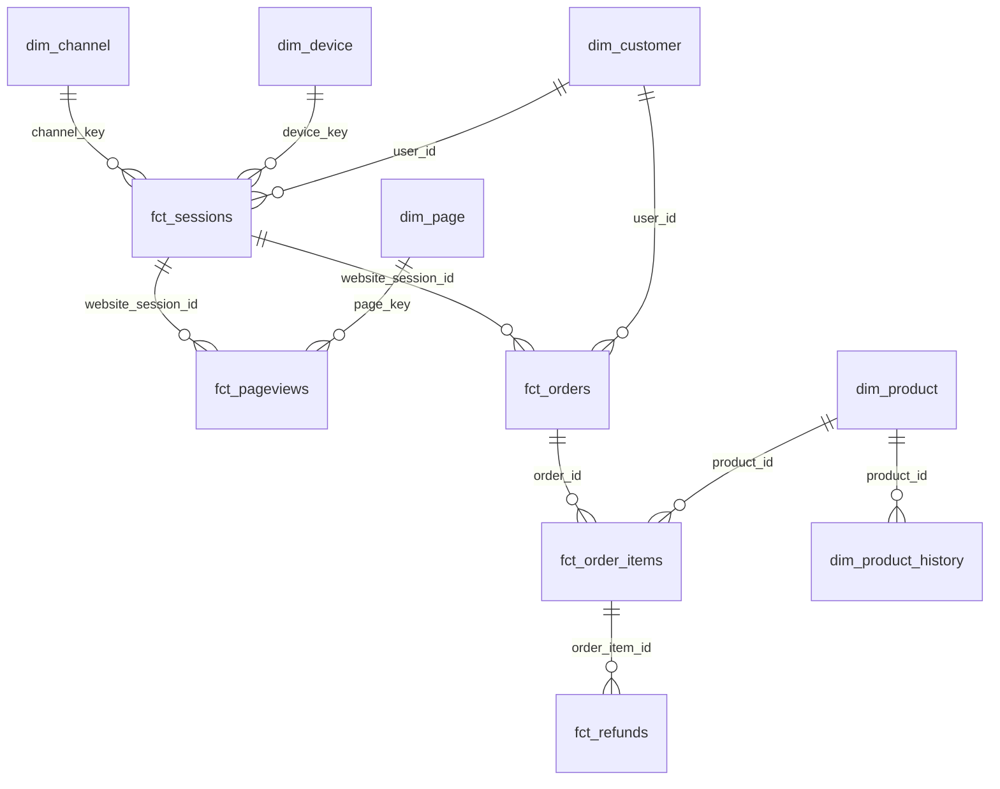

# Domain modeling contracts

Gold giữ entity/fact ở grain nguyên tử; platinum tính metric/mart. Domain được thể hiện bằng thư mục và `config.meta.domain` trong YAML. Các gold domains cùng schema `analytics_gold` để dùng conformed dimensions; có thể tách schema khi phân quyền domain được xác định. Không áp dụng data mesh ownership thực tế khi chưa có owner cụ thể.

| Domain | Model | Grain / join key |
|---|---|---|
| Shared | dim_date | date_day; calendar từ min/max sự kiện |
| Shared | dim_device | device_key; source device_type, gồm NULL |
| Acquisition | dim_channel | channel_key; UTM source/campaign/content + referrer |
| Acquisition | fct_sessions | website_session_id; channel_key, device_key, user_id |
| Engagement | dim_page | page_key; một URL, page category |
| Engagement | fct_pageviews | website_pageview_id; website_session_id, page_key, deterministic page_sequence |
| Customer | dim_customer | user_id; tổng hợp sessions/orders riêng trước khi join |
| Product | dim_product | product_id hiện tại |
| Product | dim_product_history | product_version_key; observed validity intervals |
| Commerce | fct_orders | order_id; header amount, website_session_id, user_id |
| Commerce | fct_order_items | order_item_id; order_id, product_id; item amount |
| Finance | fct_refunds | order_item_refund_id; order_item_id, order_id; event amount/date |

Relationships là contract phân tích được kiểm tra bằng dbt; trang source không khai báo foreign keys vật lý. Source datetime không kèm timezone nên không tự chuyển UTC; ngày phân tích giữ lịch nguồn. Tất cả tiền trong dataset là USD, không cần FX.

## Platinum marts

| Mart | Grain | Metrics và attribution |
|---|---|---|
| mart_marketing_daily | session_date × channel_key × device_key | Sessions, distinct converted sessions / sessions, orders, gross revenue, revenue/session. Gắn đơn hàng theo supplied website_session_id và ngày bắt đầu session |
| mart_funnel_daily | session_date × device_key | Sessions đạt chuỗi products → cart → shipping → billing → thank-you theo page_sequence tăng. Session vào cart trước products không tính cart nếu không quay lại sau products |
| mart_landing_page_daily | session_date × first page_key × device_key | Sessions có pageviews, bounce = đúng 1 pageview, converted sessions; first page tie-break bằng pageview_id |
| mart_finance_daily | date_day | Gross revenue và COGS theo ngày order; refund theo ngày refund; net = gross − refunds; gross profit after refunds = net − original COGS |
| mart_product_daily | sale_date × product_id | Units, distinct orders theo product, refunded units, lifetime observed refunds gán về ngày sale; refund rate = refunded units / sold units |
| mart_customer_cohorts | first-order cohort_month × observed purchase activity_month | Cohort size cố định, purchasing users, orders, cumulative gross revenue / cohort size; sparse activity months, chưa có refunds hoặc future extrapolation |

Order count của product mart không additive qua nhiều sản phẩm; không sum để tính global orders. Không lấy average của conversion rates: cộng tử và mẫu rồi chia. Không so sánh net revenue theo ngày giữa finance và product mart vì khác refund attribution; lifetime totals có thể reconcile. Session conversion khác orders/sessions vì một session có thể có nhiều orders.

Không có campaign spend, nên không tính ROI/ROAS. UTM có giá trị không chứng minh đó là paid traffic; channel_group chỉ phân biệt tagged_campaign, untagged_referral và direct_or_unknown. Attribution hiện dùng source session ID của order, chưa phải user-level multi-touch attribution.

Dwell time chỉ là thời gian quan sát tới pageview tiếp theo trong source session; last page giữ NULL. Source sessions được giữ nguyên, không tự sessionize lại bằng 30 phút. Funnel hoàn tất bằng page event thank-you, không đồng nhất với purchase count trong order table.

## SCD2

Product history lưu các thay đổi tên từ thời điểm pipeline quan sát; snapshot strategy check, stable natural key product_id, check_cols product_name. Sự kiện bán hàng cũ không được backfill vào observed history này. `dim_product` là current dimension cho facts; muốn event-time SCD2 cần source change history/CDC có hiệu lực thời gian thật.
